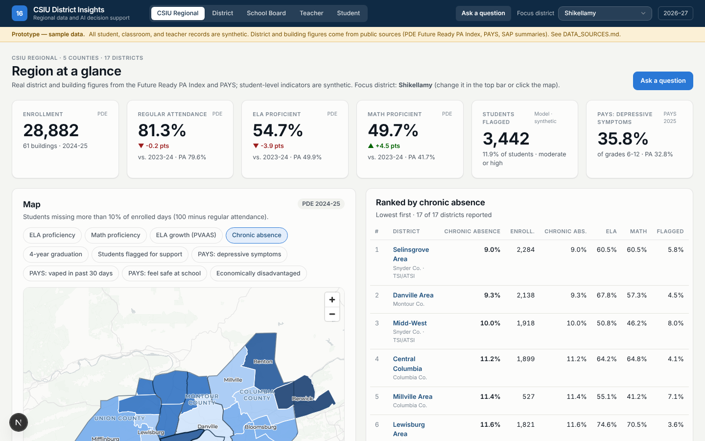

# CSIU District Insights — clickable prototype

A concept demo of a CSIU-built regional data tool for the 17 member districts of the Central Susquehanna Intermediate Unit (CSIU 16): one warehouse, a map, role-based views, AI-generated insight cards, a plain-language "Ask a question" feature, and student-level recommended strategies. It demonstrates **Version C** of the business strategy framework (warehouse + early warning + intervention-to-outcome analysis) with a hint of **Version D** (regional / multi-IU comparisons).

> **Prototype — sample data.** All student, classroom, and teacher records are synthetic and generated from a seed. District and building figures are real public data (PDE Future Ready PA Index, PAYS 2025, SAP 2025-26, Census TIGER). See [`DATA_SOURCES.md`](DATA_SOURCES.md).



## Quick start

```bash
npm install
npm run seed        # builds warehouse/insights.db (~11 s): real public data + synthetic students
npm run dev         # http://localhost:3000
```

Optional: copy `.env.example` to `.env.local` and set `ANTHROPIC_API_KEY` to enable free-form questions. The 20 example questions work without a key. PDF reports need a Chromium/Chrome install (auto-detected; or `npx playwright install chromium`, or set `CHROME_PATH`).

Other scripts: `npm run sis:load` (round-trip the sample Sapphire exports through the connector), `npm run test:ask` (runs every example question in every role), `npm run typecheck`, `npm run lint`, `npm run build`.

## A short tour

Use the role switcher in the top bar. The district selector changes which district the District / Board / Teacher / Student roles see; the CSIU role sees everything. Roles are cookies, not logins — scoping is enforced in the query layer, not just the UI.

1. **CSIU Regional** (`/regional`) — IU-wide KPIs, the map of the five counties with real district boundaries shaded by a chosen metric (hover for a card, click to open the district), rankings, four-year ELA trend with the focus district highlighted, attendance change since 2021-22, and CSIU 16 vs. all other IUs on PAYS mental-health trends (the Version D hint).
2. **Ask a question** (`/ask`) — type a question or click a chip. Try *"Show me what districts are using CKLA."*: the map highlights the CKLA districts, a table lists grades covered, adoption year, years in use, ELA proficiency, change since adoption and IU rank, a chart compares CKLA vs. non-CKLA districts, and bullets summarize. Example questions are answered deterministically; free-form questions use Claude (text-to-SQL over scoped views, then a chart choice and 3-5 bullets). A district user asking about "all districts" sees their district vs. an anonymized regional average.
3. **District** (`/district`) — the mockup's overview: KPIs, three insight cards computed from this district's data (change the district and the cards change), chronic-absence early warning with projection, flagged students by building, "what's working" with similar-student comparisons, and the student support list. Tabs: attendance, behavior, academics, wellness (real PAYS and SAP), interventions (timing and fidelity), student support list, reports.
4. **School Board** (`/board`) — four plain-language questions, comparison with last year, what the administration is doing, whether investments are paying off; no student-level detail. **Download board packet (PDF)** renders a real PDF with deliberate page breaks.
5. **Teacher** (`/teacher`) — roster-scoped: "check in with these students this week", class at a glance, classroom strategies suggested from regional patterns. Switch homerooms with the Class selector.
6. **Student** (`/student`) — a flagged student's profile: why flagged (explainable factors), strengths, attendance by month and weekday, grades vs. September, benchmarks, progress-monitoring chart, supports timeline, and **what has helped similar students** ("X% improved vs. Y% without") across attendance, behavior, academics, and wellness.
7. **Reports** (`/district/reports`) — data-ready PDF and CSV bundle for the district, board packet PDF.

## How it is built

```
warehouse/            SQLite warehouse ("the warehouse")
  schema.sql          all levels of the BSF data map: region → district → building → classroom → student
  seed/               real-data loader (real.ts), seeded synthetic generator (synth.ts), risk index (risk.ts)
  raw/frpa/           PDE Future Ready data files (real)         raw/drive/  PAYS + SAP extracts (real)
  scripts/            extract_frpa.py (Excel → JSON)
sis/                  SIS integration layer: SisConnector interface, Sapphire file connector (stub), sample exports, loader
src/lib/scope.ts      role scoping: every student-level query takes a Scope and builds its WHERE clause from it
src/lib/queries/      regional, district, board, teacher, student query modules
src/lib/ask/          views.ts (scoped TEMP views + SQL validator), library.ts (20 questions), engine.ts
src/lib/ai/           provider interface; AnthropicProvider (official SDK) and LocalProvider (no network)
src/app/              Next.js app router: /regional /ask /district/* /board /teacher /student/[id] /print/* /api/*
public/geo/           Census TIGER boundaries as GeoJSON
```

**Stack:** Next.js 16 + React + TypeScript + Tailwind v4; Recharts; MapLibre GL with the open CARTO Positron basemap (no keys); better-sqlite3; Anthropic SDK behind a swappable provider; playwright-core + Chromium for PDFs.

**Scoping, concretely.** `Scope` is resolved once per request from cookies. `studentScope()` returns the SQL fragment that restricts `students` rows (district → `s.aun = ?`, teacher → `s.classroom_id = ?`, CSIU → all) and `assertStudentLevel()` throws for the board role. "Ask a question" goes further: every query (library or model-written) runs against per-request TEMP views built from the scope, and a validator rejects any reference to a base table — so a district user's model-written SQL physically cannot read another district.

**Explainable early warning.** `warehouse/seed/risk.ts` adds points for chronic-absence pace, rising absences, Monday patterns, referrals, D/F grades and drops, screener benchmarks, wellness screens and falling check-ins; each point is a plain-language factor shown on the student page. Simplicity over sophistication, by design.

**"What works."** `interventions` holds one row per student × support with start date, days from flag to start, dosage, fidelity, funding, provider, and pre/post outcome; `student_outcomes` holds the same window for every student so treated students are compared with similar untreated students (same domain, same baseline band). The effect sizes are assumed in the generator — the point is to show the shape of the analysis that real implementation data would support.

## Where real connectors plug in

`sis/connector.ts` defines `SisConnector` with `fetch(): Promise<SisExtract>` (demographics, attendance, grades, discipline, assessment imports). The only implementation reads Sapphire-style CSVs; `SapphireApiConnector` is a stub that throws. `sis/load.ts` upserts an extract into the warehouse and depends only on the interface. PIMS, Project AWARE, and PAYS loaders would follow the same pattern in `warehouse/seed/real.ts`.

## Regenerating

- Change the synthetic universe: `SEED=anything npm run seed`.
- Refresh PDE data: download new Future Ready files into `warehouse/raw/frpa/`, run `python3 warehouse/scripts/extract_frpa.py`, then `npm run seed`.
- Refresh PAYS/SAP: re-extract to `warehouse/raw/drive/*.json` (shape documented in the files), then `npm run seed`.
